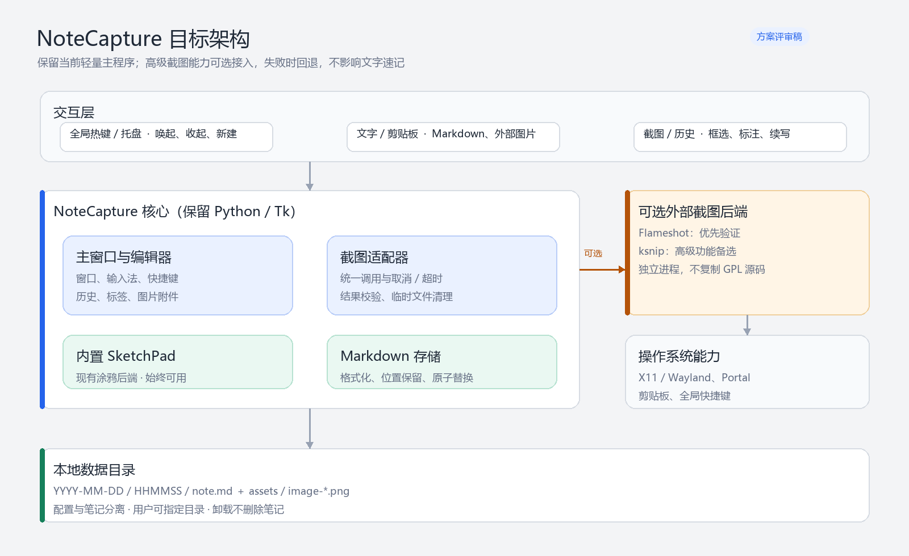
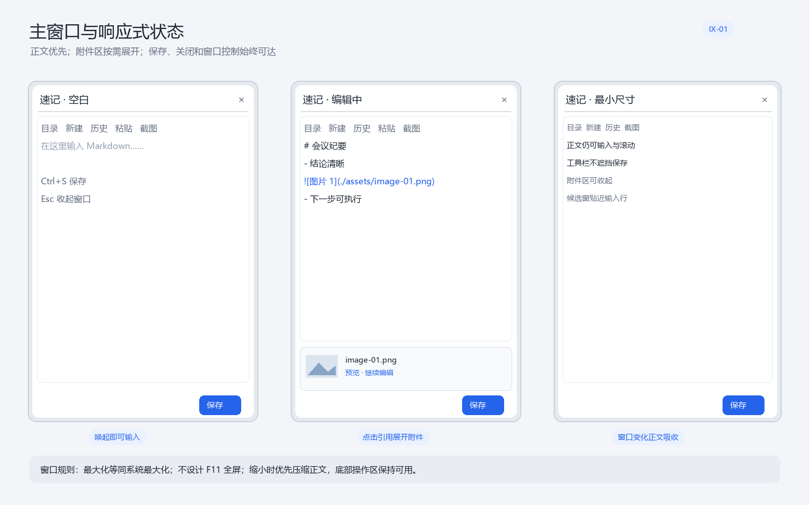
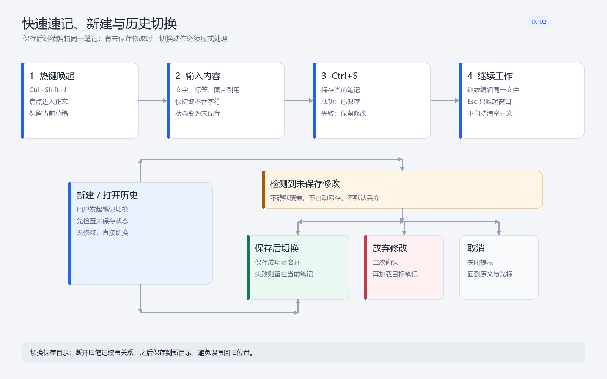
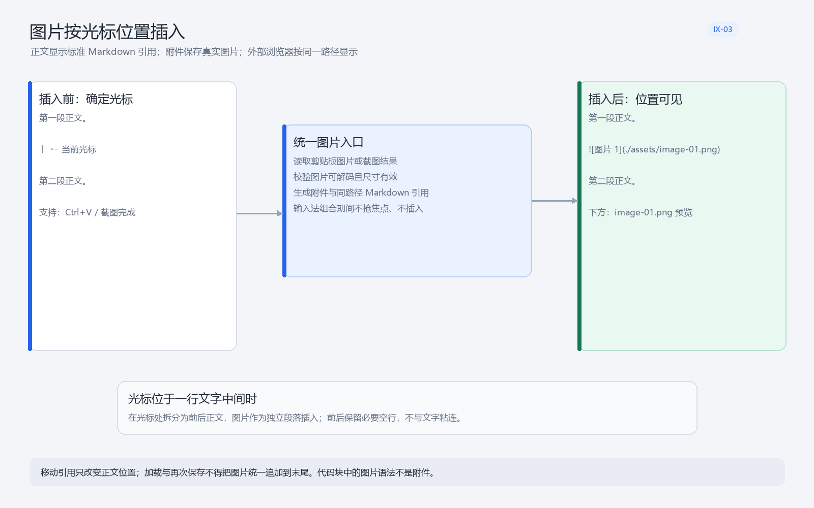
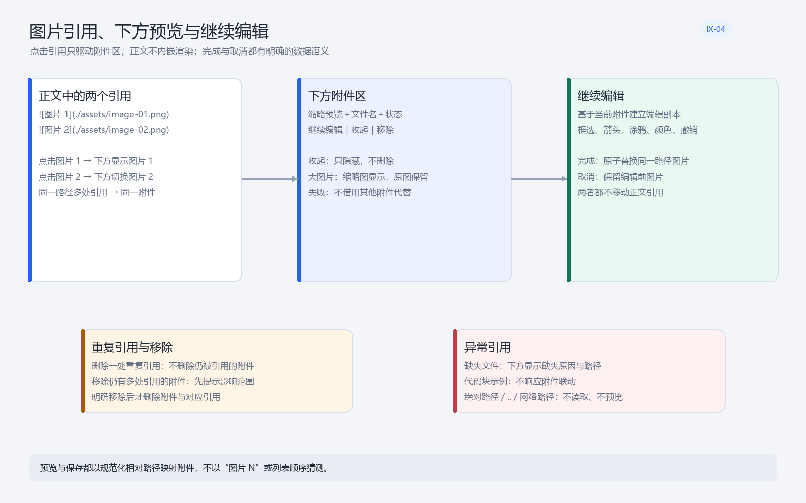
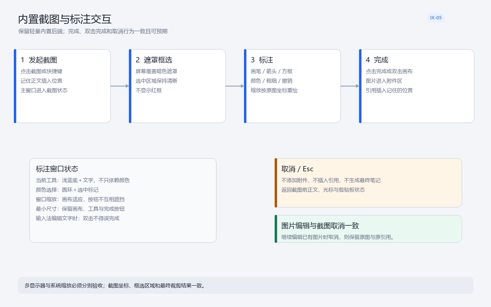
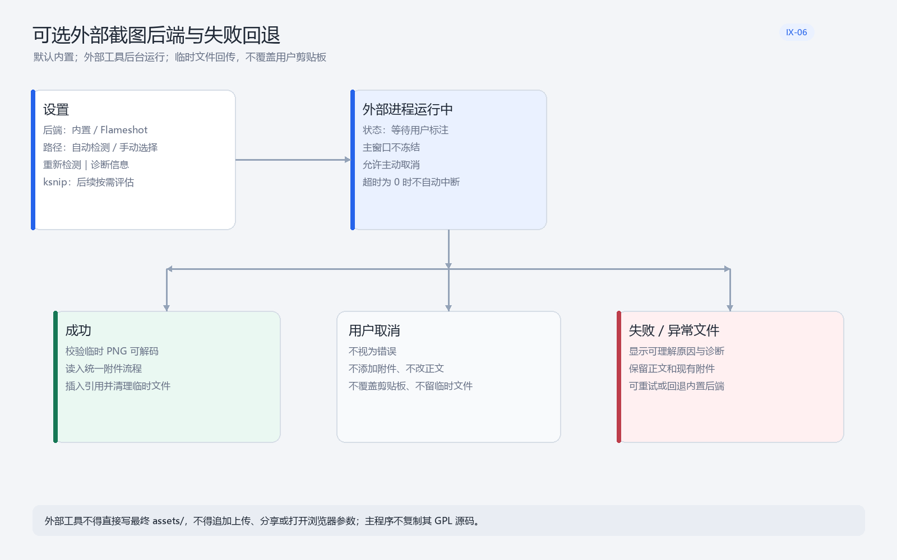
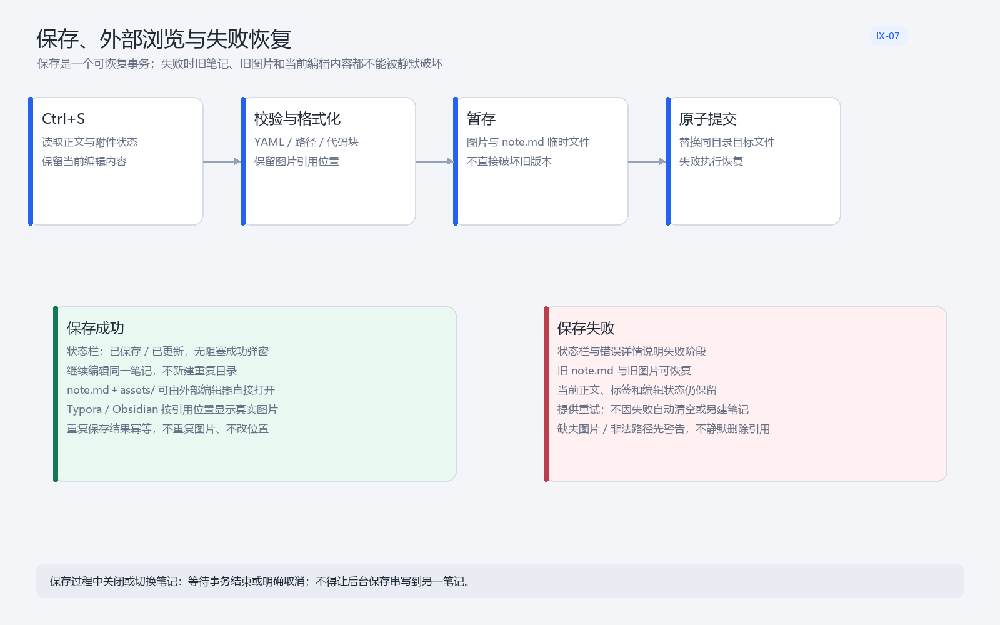
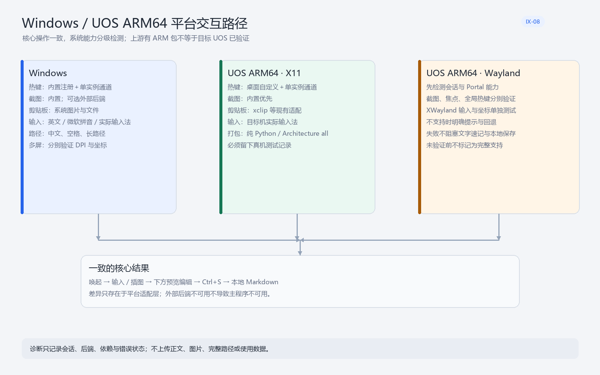

# NoteCapture 产品需求文档（PRD）

> 文档版本：v1.0（评审修订版）\
> 日期：2026-10-27\
> 文档状态：已完成一轮需求设计自审，待产品负责人确认\
> 适用平台：Windows、UOS ARM64／Linux\
> 技术基线：Python／Tk＋Pillow，本地 Markdown 文件\
> 重要声明：本文是目标产品与交互基线，不代表相关功能已经开发或已通过真机验收。

***

## 1. 文档目的与本轮评审结论

本 PRD 用于统一 NoteCapture 下一阶段的产品范围、交互行为、数据规则、异常处理与验收标准，替代此前以功能清单为主的评审稿。

### 1.1 本轮评审范围

* 快速速记、新建、历史加载与未保存修改保护。
* 剪贴板图片、截图图片与正文任意位置的 Markdown 引用。
* 点击图片引用后的下方预览、继续编辑、重复引用与异常状态。
* 内置截图标注与可选外部截图后端。
* Markdown 格式化、附件映射、保存事务与失败恢复。
* 主窗口尺寸、输入法、Windows／UOS ARM64 的平台差异。

### 1.2 评审发现与修订决策

| 评审项          | 原方案缺口或歧义                      | 本版决策                                          |
| ------------ | ----------------------------- | --------------------------------------------- |
| R-01 正文与图片预览 | “不做内置预览”可能与下方附件预览冲突           | 正文不内嵌渲染；点击图片引用后，下方附件区必须预览并可继续编辑               |
| R-02 插入位置    | “光标逻辑位置”未定义行中插入行为             | 光标在行中时拆分前后正文，图片作为独立段落插入；输入法组合期间不插入            |
| R-03 引用映射    | 不能依赖“图片 N”或列表顺序               | 使用规范化相对路径映射；同路径多引用共享附件，失败时不猜测替代               |
| R-04 图片编辑    | 完成、取消是否修改原图不够明确               | 基于副本编辑；完成原子替换同一路径图片，取消保留原图；两者均不移动引用           |
| R-05 重复引用与移除 | 多处引用下删除附件的影响不清                | 删除一处引用不删仍被使用附件；移除多引用附件须提示影响范围并确认              |
| R-06 路径与异常   | 绝对路径、越界路径、网络路径可能带来误读          | 仅接受笔记目录内 `./assets/` 相对路径；非法路径不读取、不预览、不自动改写   |
| R-07 截图异步状态  | 外部截图期间正文变化可能影响插入锚点            | 锚点随正文编辑迁移；无法定位时回到主窗，由用户确认当前位置后插入              |
| R-08 未保存修改   | 新建、历史、退出和切换目录可能覆盖当前工作         | 有修改时提供“保存后切换／放弃／取消”；保存失败不得离开当前笔记              |
| R-09 保存一致性   | 仅保存 Markdown 成功不足以保证笔记完整      | 图片与 Markdown 作为一次可恢复事务处理，失败保留旧版本和当前编辑内容       |
| R-10 平台支持声明  | “存在 ARM 包”不能证明 UOS Wayland 可用 | Windows、UOS X11、UOS Wayland 分开验收；未验证前不得标为完整支持 |

\*\*评审结论：\*\*需求可进入开发拆解，但 P0 交互、数据安全和异常测试必须作为同一交付，不得只完成“正常路径”。

***

## 2. 产品概述

### 2.1 产品定位

NoteCapture 是一个轻量、离线、本地文件优先的快速速记工具。用户通过全局热键记录文字、截图和外部图片，保存为可直接被人与程序读取的 Markdown 笔记。

### 2.2 产品目标

| 编号   | 目标          | 验收结果                                                   |
| ---- | ----------- | ------------------------------------------------------ |
| G-01 | 快速进入记录状态    | 热键唤起后焦点进入正文，无需先创建标题或选择笔记本                              |
| G-02 | 文字与图片形成同一笔记 | 一篇笔记可包含正文、标签和多张图片，图片位置由正文引用决定                          |
| G-03 | 图片可定位、可再编辑  | 点击正文引用即可在下方预览并编辑对应附件                                   |
| G-04 | 保存结果开放且可读   | `note.md` 与 `assets/` 可被 Typora、Obsidian、VS Code 等直接使用 |
| G-05 | 失败不静默丢数据    | 保存、截图、历史切换和附件异常均有明确状态与恢复路径                             |
| G-06 | 跨平台但保持轻量    | 不引入 Electron；外部截图工具不是主程序硬依赖                            |

### 2.3 本期非目标

* 不做账号、云同步、多人协作或完整笔记管理软件。
* 不做正文完整 Markdown 所见即所得，不在正文内嵌渲染图片。
* 不内嵌浏览器或 Electron，不整体替换现有 Python／Tk 技术基线。
* 不上传正文、图片、路径或使用数据，不接图床和分享流程。
* 不自动批量改写所有历史笔记；旧笔记仅在再次保存时更新格式。
* 首阶段不强制接入 ksnip、OCR、马赛克、文字标注等全部高级能力。

***

## 3. 用户与核心场景

### 3.1 目标用户

* 需要随时记录问题、会议结论、代码片段和截图的开发者或知识工作者。
* 希望笔记以普通文件保存，便于备份、外部浏览和交给大模型处理的用户。
* Windows 与 UOS ARM64 混合使用、要求离线可用的用户。

### 3.2 核心场景

1. **快速文字速记**：热键唤起，输入正文与标签，`Ctrl+S` 保存后继续编辑。
2. **截图说明问题**：框选屏幕，使用箭头、方框或涂鸦标注，图片插入正文指定位置。
3. **粘贴外部图片**：从浏览器、聊天工具或文件管理器粘贴图片，预览、编辑并保存。
4. **整理图文结构**：将图片引用剪切到另一段落，保存后外部 Markdown 浏览器按新位置显示。
5. **历史续写**：打开旧笔记继续编辑；有未保存修改时不会因切换而静默丢失。
6. **UOS 离线使用**：外部后端不可用时仍可使用文字、内置截图、本地图片和保存。

***

## 4. 产品范围与优先级

优先级定义：P0＝本阶段必须完成；P1＝本阶段建议完成；P2＝后续可选。

| 模块       | P0                         | P1           | P2             |
| -------- | -------------------------- | ------------ | -------------- |
| 速记与历史    | 热键、正文、标签、保存、未保存保护          | 状态细节优化       | 批量管理           |
| 图片与引用    | 任意位置插入、位置保留、下方预览、继续编辑、异常处理 | 附件体验优化       | 更多附件类型         |
| 截图       | 内置截图、标注、取消、结果校验            | 可选 Flameshot | ksnip、OCR、马赛克等 |
| Markdown | 新旧读取兼容、格式化、幂等、相对路径、原子保存    | 外部编辑器兼容扩展    | 全量历史格式化        |
| 平台       | Windows、UOS X11 核心链路       | Wayland 分级适配 | 更多 Linux 发行版   |

***

## 5. 目标架构



### 5.1 模块职责

| 模块           | 主要职责                       | 明确边界                  |
| ------------ | -------------------------- | --------------------- |
| 主窗口与编辑器      | 正文、标签、历史、附件展示、引用联动、保存入口    | 不直接拼装外部平台命令           |
| 附件管理         | 图片校验、缩略预览、路径映射、编辑副本、引用计数   | 不以显示顺序猜测附件            |
| 内置 SketchPad | 框选、画笔、箭头、方框、颜色、撤销与图片编辑     | 不依赖外部截图工具             |
| 截图适配器        | 后端发现、调用、取消、超时、结果校验与错误分类    | 不修改 Markdown，不直接写最终目录 |
| Markdown 存储  | YAML、格式化、图片位置保留、暂存、原子替换与恢复 | 不启动截图进程               |
| 平台能力层        | 热键、剪贴板、会话、Portal、路径与诊断     | 不向主交互泄漏无意义平台细节        |

### 5.2 外部后端配置基线

```json
{
  "screenshot_backend": "builtin",
  "flameshot_path": "",
  "ksnip_path": "",
  "external_backend_timeout_ms": 0
}
```

* 默认 `builtin`；用户主动启用外部工具。
* 路径为空时自动检测，失败后允许手动选择。
* 超时 `0` 表示不自动中断人工标注，但始终允许用户主动取消。
* 外部工具与 NoteCapture 分开安装；如后续捆绑，须另行完成许可证审查。

***

## 6. 交互设计

> 以下设计图定义信息层级、状态与操作结果，不要求逐像素复刻。任何实现不得用视觉调整为由省略异常状态或数据保护。

### 6.1 IX-01：主窗口与响应式状态



* 顶栏保留目录、新建、历史、粘贴、截图和窗口控制；高级后端配置放设置。
* 正文是第一优先级，附件区第二，标签与保存操作保持稳定可达。
* 最大化使用操作系统普通最大化，不设计 F11 全屏。
* 设置最小窗口尺寸；缩小时主要由正文吸收变化，工具栏不得遮蔽保存按钮。
* 正文与下方附件区可滚动；附件区收起后正文扩展。
* 中文候选窗应贴近输入行，不得因窗口移动或缩放明显乱跳。

### 6.2 IX-02：快速速记、新建与历史切换



* `Ctrl+Shift+J` 唤起或收起主窗口；唤起后焦点进入正文。
* `Ctrl+S` 只执行保存，不得向正文输入 `s`，不得清空当前内容。
* `Esc` 在普通主窗口中只收起，不自动保存、不删除草稿。
* 新建、打开历史或退出前检查未保存状态。
* 有修改时提供“保存后切换／放弃修改／取消”；默认焦点不放在“放弃修改”。
* 选择保存后切换时，只有保存成功才加载目标笔记；失败留在当前笔记。
* 切换保存目录后断开旧笔记续写关系，后续保存不得写回旧目录。

### 6.3 IX-03：图片按光标位置插入



* 剪贴板粘贴和截图完成进入同一附件流程。
* 新图片在记住的正文位置插入标准引用：``。
* 光标在空行时直接插入；在行首或行尾时保持相邻段落结构；在行中时拆分前后正文。
* 图片引用作为独立段落，前后保留必要空行。
* 输入法组合期间不抢焦点、不插入；截图返回时如锚点失效，由用户确认当前位置。
* 正文只显示引用，不显示私有占位符，也不内嵌渲染图片。

### 6.4 IX-04：图片引用、下方预览与继续编辑



* 点击完整、合法的本地图片引用，下方附件区展开并定位对应图片。
* 下方显示缩略预览、文件名、状态以及“继续编辑／收起／移除”。
* 点击不同引用时切换预览，不弹出遮挡正文的新预览窗口。
* 同一路径多处引用共享同一附件，不复制图片文件。
* 收起只隐藏附件区，不删除附件或引用。
* 继续编辑基于副本；完成原子替换同一路径图片，取消保留编辑前图片。
* 移除仍被多处引用的附件前，提示将影响的引用数量；确认后才移除附件与对应引用。
* 缺失文件显示缺失原因，不展示其他附件代替；代码块示例不触发联动。

### 6.5 IX-05：内置截图与标注



* 屏幕使用暗色遮罩，选中区域保持清晰，不显示红框。
* 标注工具包括画笔、箭头、方框、颜色、粗细和撤销；后续增强不得破坏现有操作。
* 点击“完成”或双击画布均可完成；文字标注输入状态下双击不得误完成。
* 所有标注映射原图坐标；窗口缩放只改变显示，不改变最终标注位置。
* 取消不添加附件、不插入引用、不生成最终笔记、不覆盖剪贴板。
* 工具栏、颜色和完成按钮在最小窗口下仍可用，不得相互遮挡。

### 6.6 IX-06：可选外部截图后端



* 首阶段优先验证 Flameshot；未安装外部工具不影响内置流程。
* 外部进程后台运行，主窗口保持响应并显示等待、取消和返回状态。
* 结果优先通过临时 PNG 回传，不以覆盖用户剪贴板作为传输方式。
* 成功、用户取消、启动失败、异常退出、超时和损坏图片必须分别处理。
* 用户取消不是错误，不弹错误框；失败提供诊断、重试和回退内置入口。
* 外部工具不得直接写最终 `assets/`，不得追加上传、分享或打开浏览器参数。

### 6.7 IX-07：保存、外部浏览与失败恢复



* 保存流程：读取一致状态 → 校验与格式化 → 暂存图片和 Markdown → 原子提交。
* 保存成功后继续编辑同一笔记，不新建重复目录，不重复生成图片。
* 成功使用状态栏反馈，不使用阻塞式成功弹窗。
* 失败保留旧 `note.md`、旧图片和当前编辑内容，并提供错误详情与重试。
* 保存期间关闭或切换笔记须等待事务结束或明确取消，不得串写到另一笔记。
* 缺失图片或非法路径须警告；不静默删除引用，也不用其他文件替代。

### 6.8 IX-08：Windows／UOS ARM64 平台路径



* 核心链路一致：唤起 → 输入／插图 → 下方预览编辑 → `Ctrl+S` → 本地 Markdown。
* Windows、UOS X11、UOS Wayland 分别检测与验收，不以单一平台结果代替全部。
* Wayland 的截图、焦点、Portal、全局热键与 XWayland 输入须单独验证。
* 平台能力失败时回退到可用路径，不得阻塞文字速记与本地保存。

***

## 7. 功能需求

### 7.1 编辑器、历史与窗口

| 编号       | 优先级 | 状态    | 需求                              |
| -------- | --- | ----- | ------------------------------- |
| NC-ED-01 | P0  | 已有／保持 | 全局热键唤起与收起；焦点进入正文，不抢占输入法组合键      |
| NC-ED-02 | P0  | 已有／保持 | 英文、中文和常用符号可正常输入，快捷键不吞字符、不清理已有选区 |
| NC-ED-03 | P0  | 已有／保持 | `Ctrl+S` 保存且不输入 `s`；成功后继续编辑同一笔记 |
| NC-ED-04 | P0  | 待完善   | 新建、历史和退出前执行未保存保护，保存失败不得切换       |
| NC-ED-05 | P0  | 已有／保持 | 支持指定保存目录；切换后断开旧目录续写关系           |
| NC-ED-06 | P0  | 已有／保持 | 支持普通最大化、尺寸记忆和最小可用尺寸             |
| NC-ED-07 | P0  | 已有／保持 | `Esc` 在主窗口只收起；对话框和截图内按上下文执行取消   |
| NC-ED-08 | P1  | 待完善   | 清晰显示未保存、保存中、已保存和失败状态            |
| NC-ED-09 | P0  | 已有／保持 | 标签可编辑并正确写入 YAML，新旧标签格式均可读取      |
| NC-ED-10 | P1  | 持续优化  | 窗口缩放、拖动和输入法候选窗不导致正文遮挡或焦点异常      |

### 7.2 图片、引用与附件

| 编号       | 优先级 | 状态    | 需求                                   |
| -------- | --- | ----- | ------------------------------------ |
| NC-IM-01 | P0  | 已有／改造 | 剪贴板图像、图片文件和截图结果进入统一附件流程              |
| NC-IM-02 | P0  | 待开发   | 图片引用插入记住的光标位置；行中插入按本 PRD 规则拆分段落      |
| NC-IM-03 | P0  | 待开发   | 正文显示标准 Markdown 引用，引用行即位置标记，不使用私有占位符 |
| NC-IM-04 | P0  | 待开发   | 加载与再次保存保留引用位置和顺序，不统一追加到末尾            |
| NC-IM-05 | P0  | 待开发   | 剪切、复制、粘贴引用只改变正文位置，不重命名或复制附件          |
| NC-IM-06 | P0  | 待开发   | 点击引用在下方展开对应图片预览和继续编辑入口               |
| NC-IM-07 | P0  | 待开发   | 多引用切换准确；同路径多引用定位同一附件                 |
| NC-IM-08 | P0  | 已有／保持 | 附件区可收起，收起不删除附件、引用或标注                 |
| NC-IM-09 | P0  | 待完善   | 编辑完成原子替换同路径图片；取消保留原图；引用位置均不变         |
| NC-IM-10 | P0  | 待开发   | 删除一处重复引用不删除仍被引用附件；移除多引用附件须确认影响范围     |
| NC-IM-11 | P1  | 待开发   | 未引用附件默认在末尾补回引用，只有明确移除才删除             |
| NC-IM-12 | P1  | 待开发   | 旧版末尾图片原样可读，用户移动后保存保留新位置              |
| NC-IM-13 | P0  | 待开发   | 缺失、失效或不完整引用不触发错误附件；代码块内语法不联动         |
| NC-IM-14 | P0  | 待开发   | 仅映射笔记内安全相对路径，拒绝绝对路径、`..` 越界和网络路径     |
| NC-IM-15 | P1  | 待完善   | 大图使用缩略预览并复用缓存，不降低最终保存图片分辨率           |

### 7.3 截图与外部后端

| 编号       | 优先级 | 状态    | 需求                            |
| -------- | --- | ----- | ----------------------------- |
| NC-SC-01 | P0  | 已有／保持 | 默认内置截图始终可用，外部工具不是硬依赖          |
| NC-SC-02 | P0  | 已有／保持 | 遮罩屏幕、选中区域清晰、无红框，框选与裁剪坐标一致     |
| NC-SC-03 | P0  | 已有／保持 | 画笔、箭头、方框、颜色、粗细和撤销可用           |
| NC-SC-04 | P0  | 已有／保持 | 完成按钮与双击画布完成；文字输入状态防止误完成       |
| NC-SC-05 | P0  | 已有／保持 | 取消不添加附件、不改正文、不覆盖剪贴板、不生成最终笔记   |
| NC-SC-06 | P0  | 持续验证  | 多显示器、系统缩放和窗口缩放不改变最终标注位置       |
| NC-SC-07 | P0  | 待开发   | 统一截图结果协议，区分成功、取消和各类失败         |
| NC-SC-08 | P0  | 待开发   | 外部进程后台执行，UI 不冻结，支持主动取消和状态反馈   |
| NC-SC-09 | P0  | 待开发   | 图片必须存在、可解码且尺寸有效，校验后才可加入附件     |
| NC-SC-10 | P0  | 待开发   | 临时文件成功、取消和失败后均清理；外部工具不直接写最终目录 |
| NC-SC-11 | P1  | 待开发   | 设置显示后端、路径、检测状态、重新检测和诊断入口      |
| NC-SC-12 | P2  | 后续    | ksnip、OCR、马赛克等按真实需求另行评估       |

### 7.4 Markdown 与保存

| 编号       | 优先级 | 状态     | 需求                                                             |
| -------- | --- | ------ | -------------------------------------------------------------- |
| NC-MD-01 | P0  | 已实现待验证 | UTF-8、LF、单个文件末尾换行，正文普通空行保守规范化                                  |
| NC-MD-02 | P0  | 已实现待验证 | 围栏代码块原样保留，代码块内图片示例不参与附件处理                                      |
| NC-MD-03 | P0  | 已实现待验证 | YAML 包含 `id`、`type`、`title`、`created`、`source`、`tags`、`assets` |
| NC-MD-04 | P0  | 已实现待验证 | 图片使用 `./assets/image-XX.png` 相对路径并独立成段                         |
| NC-MD-05 | P0  | 待改造    | 格式化不得移动正文引用，不改变用户列表、标题或代码缩进                                    |
| NC-MD-06 | P0  | 待验证    | 重复保存幂等，不重复笔记目录、附件或 YAML 项                                      |
| NC-MD-07 | P0  | 已有／保持  | 图片与 Markdown 先暂存，再原子替换；失败可恢复旧版本                                |
| NC-MD-08 | P0  | 已有／保持  | 保存失败保留当前正文、标签、附件状态和重试入口                                        |
| NC-MD-09 | P0  | 待开发    | 保存前检查缺失图片与非法路径，默认不提交；用户明确选择后才可带警告保存                            |
| NC-MD-10 | P1  | 待验收    | 至少一种目标外部编辑器正确显示正文、图片位置和相对路径附件                                  |
| NC-MD-11 | P1  | 已有／保持  | 读取旧笔记不静默改写；再次保存才生成新格式                                          |
| NC-MD-12 | P2  | 待决策    | 是否提供全量历史格式化，默认不自动执行                                            |

***

## 8. Markdown 与附件数据规范

### 8.1 目标文件结构

```text
<用户保存目录>/
└── YYYY-MM-DD/
    └── HHMMSS/
        ├── note.md
        └── assets/
            ├── image-01.png
            └── image-02.png
```

同秒冲突使用递增后缀。配置与笔记分离；卸载或升级不得删除用户笔记。

### 8.2 Markdown 示例

```markdown
---
id: 20261027-133400
type: clip
title: "示例标题"
created: 2026-10-27T13:34:00+08:00
source:
  app: ""
  title: ""
tags:
  - "工作"
  - "测试"
assets:
  - path: "./assets/image-01.png"
    kind: screenshot
---

# 示例标题

第一段正文。


- 要点一
- 要点二
```

### 8.3 附件映射规则

1. 相对路径是引用与附件的唯一映射依据，不使用显示顺序或替代文字猜测。
2. 生成路径统一为 `./assets/image-XX.png`；读取时规范化分隔符，但不允许越出笔记目录。
3. 同一路径多次引用共享文件；删除一处引用不影响其余引用。
4. 移动引用不修改文件名和图片内容。
5. 未引用附件默认补回末尾，防止静默丢图；明确移除是删除附件的唯一主动入口。
6. 加载与保存保持引用位置、数量和实际附件一致。
7. 代码块中的图片语法不参与引用计数、预览或补图。
8. 非法路径不读取、不预览；缺失文件不自动用其他附件替代。

### 8.4 格式化边界

\*\*允许：\*\*统一换行、合并三个及以上连续空行、清理普通行无意义行尾空白、保留 Markdown 两空格强制换行。

\*\*禁止：\*\*自动改写标题或列表、重排代码、修改代码块空行、将本地图片转为 base64、重复插入标题 H1、把所有图片引用移到末尾。

***

## 9. 状态与异常文案

### 9.1 主状态

| 状态     | 界面表现        | 允许操作            |
| ------ | ----------- | --------------- |
| 空白／已保存 | 状态稳定，无未保存标记 | 输入、插图、历史、新建、截图  |
| 未保存    | 显示未保存状态     | 保存、继续编辑；切换时保护   |
| 截图等待   | 显示后端与等待状态   | 取消；主窗口保持响应      |
| 保存中    | 禁止重复提交同一事务  | 等待或按设计取消，不并发切换  |
| 保存失败   | 状态栏＋错误详情    | 重试、修复路径、继续保留编辑  |
| 附件异常   | 下方显示具体附件和原因 | 修复、重新选择、明确移除或返回 |

### 9.2 最小异常文案原则

* 说明对象：哪张图片、哪次保存或哪个后端。
* 说明结果：正文是否保留、旧文件是否保留、是否已添加附件。
* 给出下一步：重试、回退内置、重新选择目录或返回编辑。
* 用户主动取消不显示为失败。
* 日志记录诊断状态，不记录完整正文、图片内容或完整用户路径。

***

## 10. 非功能、安全与隐私要求

| 编号       | 要求                                  |
| -------- | ----------------------------------- |
| NC-NF-01 | 输入过程中不执行全文档磁盘写入或无必要的全文扫描            |
| NC-NF-02 | 外部截图与大图解码不得冻结主窗口；UI 更新回到主线程         |
| NC-NF-03 | 缩略预览限制显示尺寸并复用缓存，最终图片保持原始有效分辨率       |
| NC-NF-04 | 核心功能离线可用，不要求账号，不上传用户内容              |
| NC-NF-05 | 不新增 Electron 等重型运行时；外部后端可删除且不影响核心流程 |
| NC-NF-06 | 中文、空格和合理长路径可用；所有进程参数使用安全参数列表传递      |
| NC-NF-07 | 附件预览限制在笔记目录内，防止越界读取和网络请求            |
| NC-NF-08 | 工具状态不仅依赖颜色；按钮具备默认、悬停、按下、选中与禁用状态     |
| NC-NF-09 | 键盘焦点清晰；危险操作默认不聚焦，确认框支持 `Esc` 取消     |
| NC-NF-10 | 升级、覆盖安装和卸载不删除用户笔记；诊断可定位平台与保存错误      |

***

## 11. 平台要求

| 项目   | Windows         | UOS ARM64／X11                     | UOS ARM64／Wayland        |
| ---- | --------------- | --------------------------------- | ------------------------ |
| 主程序  | Python／Tk       | 纯 Python，无 x86 原生二进制复制            | 同左                       |
| 热键   | 内置注册＋单实例通道      | 桌面自定义快捷键＋单实例通道                    | 按桌面能力验证，不能默认等同 X11       |
| 截图   | 内置；可选外部后端       | 内置优先，外部逐版本验证                      | Portal／可用后端单独验证          |
| 剪贴板  | 系统图片与文件         | `xclip` 等现有适配                     | `wl-paste`／Portal 等按环境验证 |
| 输入   | 英文、微软拼音、用户实际输入法 | 目标机实际输入法                          | 额外验证 XWayland 场景         |
| 打包   | 启动脚本／安装包        | `Architecture: all` 的 `.deb` 或便携包 | 同包但必须单独验收                |
| 发布声明 | 测试后标记           | 真机通过后标记                           | 未通过时注明限制，不得标完整支持         |

必须验证目标 UOS 版本的 Python／Tk、glibc、Qt（仅外部工具需要时）、D-Bus、Portal、窗口激活、截图坐标和中文输入。

***

## 12. 验收测试矩阵

### 12.1 速记、图片与保存

| 编号    | 测试                       | 通过标准                   |
| ----- | ------------------------ | ---------------------- |
| AT-01 | 热键唤起并输入英文、中文、`#()` 等符号   | 字符完整，快捷键不吞键、不清除选区      |
| AT-02 | 按 `Ctrl+S`               | 只保存，不输入 `s`，成功后仍可继续编辑  |
| AT-03 | 有修改时新建、打开历史或退出           | 三个选择行为正确；保存失败不离开当前笔记   |
| AT-04 | 切换保存目录后保存                | 写入新目录，不更新旧目录笔记         |
| AT-05 | 在两段之间和一行中间分别插图           | 引用位置正确，行中按规则拆分，必要空行存在  |
| AT-06 | 两张图片插入不同段落后保存并外部打开       | 两个位置均显示正确真实图片          |
| AT-07 | 加载含段间图片的旧笔记并重复保存         | 位置、顺序、文件名与内容不变，结果幂等    |
| AT-08 | 剪切引用并粘贴到另一段落             | 只移动引用，不复制或重命名附件        |
| AT-09 | 点击两个不同引用                 | 下方预览准确切换，不打开遮挡正文的新预览窗  |
| AT-10 | 同一路径多处引用与单处删除            | 共享附件；删除一处不影响其他引用       |
| AT-11 | 继续编辑后分别完成和取消             | 完成替换同路径图片；取消保留原图；引用均不动 |
| AT-12 | 移除多引用附件                  | 显示影响数量，确认前无变化，确认后结果一致  |
| AT-13 | 未引用附件保存                  | 默认补回末尾；明确移除的附件不补回      |
| AT-14 | 缺失图片、非法路径和代码块示例          | 不读取越界文件、不借用其他图片、不修改代码块 |
| AT-15 | 保存过程中模拟图片或 Markdown 写入失败 | 旧版本可恢复，当前编辑内容保留，可重试    |
| AT-16 | 连续重复保存                   | 不新增重复笔记、附件或 YAML 项     |

### 12.2 截图与外部后端

| 编号    | 测试                  | 通过标准                    |
| ----- | ------------------- | ----------------------- |
| AT-17 | 未安装外部工具使用内置截图       | 完整流程不受影响                |
| AT-18 | 框选、标注、完成按钮和双击画布     | 结果一致，图片进入附件和正确引用位置      |
| AT-19 | 截图或图片编辑取消           | 无附件变化、无正文变化、无错误弹窗       |
| AT-20 | 调整标注窗口和多屏 DPI       | 标注位置、框选和裁剪与原图一致         |
| AT-21 | 外部工具不存在或启动失败        | 有诊断，可回退内置，不崩溃           |
| AT-22 | 外部工具完成、取消、异常退出、损坏文件 | 各分支符合状态定义，临时文件清理        |
| AT-23 | 外部进程运行期间操作主窗口       | UI 不冻结；插入锚点按规则迁移或请求确认   |
| AT-24 | 检查外部调用参数与文件写入       | 不上传、不分享、不覆盖剪贴板、不直接写最终目录 |

### 12.3 视觉、平台与浏览

| 编号    | 测试                           | 通过标准                     |
| ----- | ---------------------------- | ------------------------ |
| AT-25 | 最小窗口、普通窗口和最大化切换              | 保存与工具不被遮挡，正文吸收主要尺寸变化     |
| AT-26 | 用户实际中文输入法                    | 候选窗不明显遮挡输入行或异常跳动         |
| AT-27 | 代码块、标题、列表、中文标点和强制换行          | 格式化边界符合规范，无字符丢失          |
| AT-28 | Typora／Obsidian／VS Code 至少一种 | 正文结构清晰，图片按引用位置显示         |
| AT-29 | Windows 中文、空格、长路径            | 图片和 Markdown 可写、可读、可再次保存 |
| AT-30 | UOS ARM64 X11 与 Wayland 分别测试 | 各自形成热键、截图、输入、剪贴板、保存的真机记录 |

***

## 13. 实施拆分

### 阶段 1：图片位置与附件联动

* 建立安全相对路径映射和附件引用计数。
* 实现光标插入、位置保留、旧笔记兼容与幂等保存。
* 实现点击引用、下方预览、多图切换、继续编辑和异常状态。
* 输出：Windows 可测试版本与 AT-05～AT-16 测试记录。

### 阶段 2：交互保护与统一截图适配层

* 完成未保存修改保护、保存事务状态和目录切换隔离。
* 抽象内置／外部结果、取消、临时文件、校验与诊断。
* 保持默认内置，不改变现有截图习惯。
* 输出：适配层、交互测试和失败注入测试。

### 阶段 3：Flameshot 可选接入

* Windows 自动／手动路径检测与设置入口。
* 临时文件回传、失败回退和隐私参数约束。
* 输出：可选外部后端的 Windows 测试版本。

### 阶段 4：UOS ARM64 验证与发布

* 分别验证 X11／Wayland、中文输入、多屏、缩放和保存。
* 更新诊断、依赖说明和 `.deb`／便携包。
* 输出：真机测试记录、明确支持矩阵与发布包。

### 后续可选

根据真实反馈决定 ksnip、文字标注、马赛克、OCR 或历史批量格式化，不以功能数量为目标。

***

## 14. 完成定义（Definition of Done）

只有同时满足以下条件，本阶段才算完成：

* 本阶段范围内的 AT-01～AT-30 全部执行；P0 需求对应测试必须全部通过，受限平台项须明确记录，不以“暂未测试”代替通过。
* 图片任意位置插入、加载保存位置保持、引用移动和旧笔记兼容均通过。
* 点击引用能在下方准确预览并继续编辑；重复引用、缺失文件和代码块示例均有测试。
* 新建、历史、退出与保存目录切换不会静默覆盖未保存内容。
* 默认内置截图与现有核心流程无回归；外部后端完成、取消、失败和异常文件均有测试。
* Markdown 新旧格式兼容、代码块保护、原子保存、失败恢复和重复保存幂等通过。
* Windows 与目标 UOS ARM64 分别留下真机记录；Wayland 未验证时明确标注限制。
* 发布包不包含未声明依赖，不上传用户内容，不删除历史笔记。

***

## 15. 待最终确认的发布决策

以下不影响交互设计继续评审，但会影响实施范围与发布说明：

1. 首阶段外部后端仅接入 Flameshot，ksnip 保持后续可选。
2. 外部工具与 NoteCapture 分开安装，不在首版捆绑。
3. 外部 Markdown 浏览首期至少指定一种目标编辑器作为正式验收环境。
4. 全量历史笔记格式化默认不执行，是否提供手动工具另行决策。

***

## 16. 需求追溯

本版完整继承并修订以下已确认方向：

* 保持轻量、离线、本地 Markdown 和现有 Python／Tk 技术基线。
* 保存快捷键为 `Ctrl+S`，截图不再设置“截图完成快捷键”，双击画布可完成。
* 截图为暗色遮罩、选区清晰、无红框；主窗口采用轻阴影和中性色层级。
* 最大化即普通系统最大化；窗口缩放主要改变正文区域。
* 图片可插入正文不同位置，正文显示标准引用，下方附件区负责预览与编辑。
* 保存后的 Markdown 在外部编辑器中按引用位置显示真实图片。

原始评审稿保留用于对照；实施与验收以本 PRD 的编号和规则为准。
