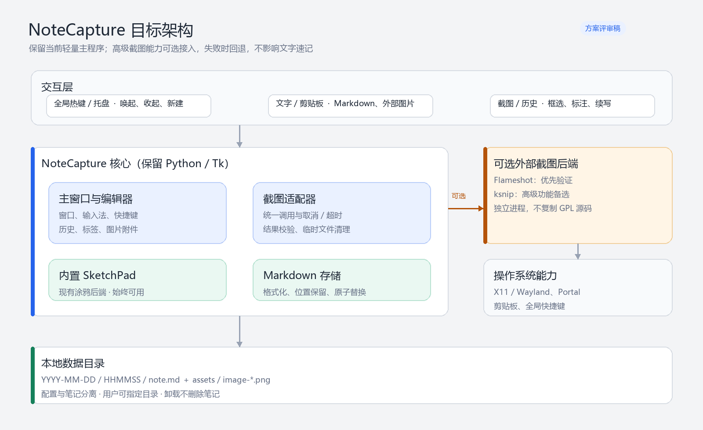
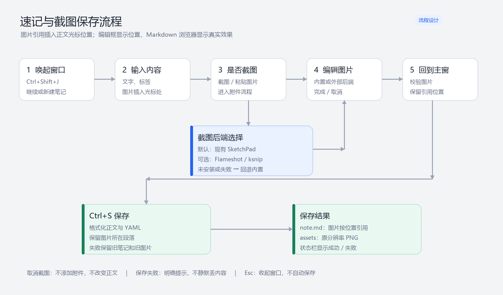
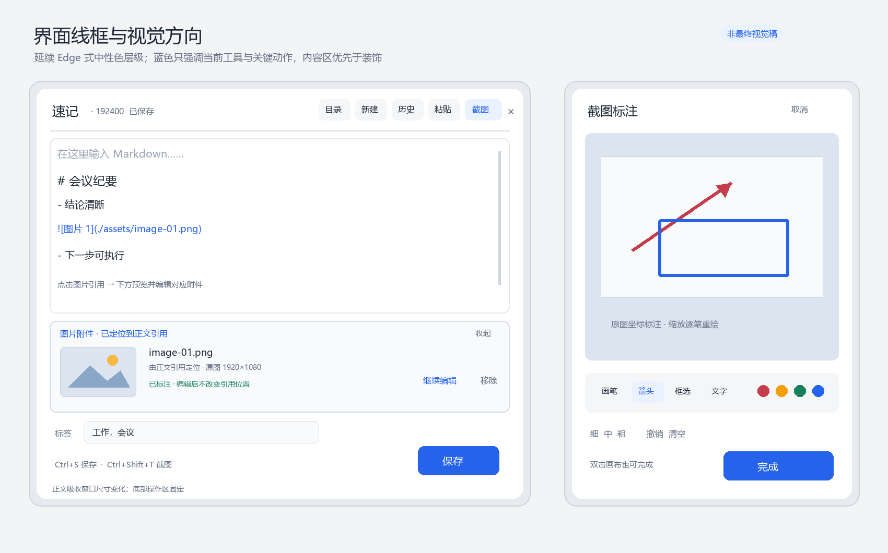

# NoteCapture 产品需求与下一阶段技术方案

> 版本：v0.3（评审稿）  
> 日期：2026-10-27  
> 状态：待产品与技术评审，**本文不作为已完成开发声明**  
> 评审范围：快速速记、截图标注、可选外部截图后端、Markdown 保存与外部浏览、Windows／UOS ARM64

---

## 1. 背景与方案结论

NoteCapture 已具备全局热键唤起、文字输入、剪贴板图片、截图涂鸦、历史续写、指定保存目录和本地 Markdown 存储。现阶段的主要矛盾不是“缺少一个完整笔记软件”，而是：

1. 内置截图标注工具需要继续增强，但不希望主程序变重。
2. 截图、输入法和窗口行为已经做过 Windows／UOS 适配，不宜整体推翻。
3. 保存结果既要供程序和大模型读取，也要方便人用 Typora、Obsidian、VS Code 等工具直接浏览。
4. Windows 与 UOS ARM64 的截图、剪贴板、Wayland 和全局快捷键差异需要被明确隔离。

**建议结论：保留当前 Python／Tk + Pillow 主程序，新增统一截图适配层；Flameshot 作为优先验证的可选外部后端，ksnip 作为后续备选；现有 SketchPad 永久保留为内置回退。**

本方案不采用整体迁移到 Gravity、QOwnNotes、Joplin 或 Electron 的路线。Gravity 的保存可靠性设计可以参考，但不作为当前替换基座。

## 2. 产品目标与非目标

### 2.1 产品目标

| 编号 | 目标 | 衡量方式 |
|---|---|---|
| G1 | 快速记录，不强迫用户先管理笔记 | 热键唤起后即可输入；`Ctrl+S` 直接保存 |
| G2 | 文字、截图和外部图片进入同一条笔记链路 | 同一笔记可包含正文、标签和多张图片 |
| G3 | 高级截图能力可按需启用 | 未安装外部工具时，全部现有功能仍可使用 |
| G4 | 保存失败不静默丢内容 | 失败有明确提示；旧笔记与旧图片可恢复 |
| G5 | Markdown 对人类和程序都可读 | YAML 合法、正文整洁、图片相对路径可预览 |
| G6 | Windows 与 UOS ARM64 使用一致的核心交互 | 核心测试矩阵通过，平台差异有回退路径 |

### 2.2 本期建议不做

以下内容不是永久排除，而是避免下一阶段失去焦点：

- 不重写为完整笔记管理软件，不引入账号、云同步或协作。
- 不替换现有数据目录，不强制迁移历史笔记。
- 不内嵌完整浏览器或 Electron 运行时。
- 不直接复制 Flameshot／ksnip 的 GPL 源码进主程序。
- 不在默认流程中上传图片；外部工具的图床上传功能不属于本方案。
- 支持图片在正文任意位置插入，但暂不以“编辑器内嵌图片预览、完整 Markdown 所见即所得”为验收条件。
- 暂不自动批量改写全部历史笔记；历史笔记在重新保存时使用新格式。

## 3. 目标用户与核心场景

### 场景 A：快速文字速记

用户在阅读、编程或会议中按 `Ctrl+Shift+J`，输入文字和标签，按 `Ctrl+S`，随后继续工作或续写同一份笔记。

### 场景 B：截图并标注问题

用户框选屏幕区域，使用箭头、方框或涂鸦指出问题，完成后图片回到主窗口；补充文字后保存，图片以原分辨率进入 `assets/`。

### 场景 C：粘贴外部图片

用户从浏览器、聊天工具或文件管理器复制图片，在主窗口 `Ctrl+V`，按需标注，再与文字一起保存。

### 场景 D：外部浏览与二次加工

用户直接在文件管理器打开笔记目录，用 Markdown 编辑器查看正文和图片，或将整个笔记目录交给其他程序／大模型处理。

### 场景 E：UOS ARM64 离线环境

用户在 UOS ARM64 上使用本地安装包，无账号、无云依赖；若外部截图后端不可用，仍能使用内置截图和文字速记。

## 4. 当前基线与差距

| 领域 | 当前基线 | 主要差距 | 下一阶段策略 |
|---|---|---|---|
| 主窗口 | 热键、历史、新建、目录、最大化、尺寸记忆 | 高级设置入口有限 | 保持轻量，只增加必要后端设置 |
| 文本输入 | 中文输入、撤销、粘贴、Markdown 原文编辑 | 不提供完整渲染预览 | 保持原文编辑，优先保证输入法稳定 |
| 截图标注 | 框选、画笔、箭头、矩形、颜色、粗细、撤销 | 文字、马赛克等高级能力有限 | 可选外部后端，不强行扩充 Tk 画布 |
| 图片附件 | 剪贴板图片、多图保存、收起编辑区；当前图片引用统一在正文末尾 | 不能指定图片在正文中的位置；外部结果来源和失败处理需统一 | 正文保留可见图片引用并记录位置；统一适配器与结果校验 |
| Markdown | 已有 YAML、正文、图片引用；保存时格式化已加入源码 | 旧格式与新格式需长期兼容 | 保留读取兼容，新增格式测试 |
| 数据安全 | 临时文件、原子替换、图片备份恢复 | 外部进程取消／超时／临时文件待规范 | 明确进程与文件生命周期 |
| 跨平台 | Windows 与 UOS 均有运行路径 | Wayland、Portal、外部后端差异 | 平台能力检测＋内置回退 |

## 5. 目标架构



### 5.1 模块职责

| 模块 | 职责 | 不应承担的职责 |
|---|---|---|
| 主窗口与编辑器 | 文本、标签、历史、附件展示、保存入口 | 不直接拼装外部平台命令 |
| 截图适配器 | 后端发现、调用、取消、超时、结果校验、错误分类 | 不修改 Markdown，不直接写最终笔记目录 |
| 内置 SketchPad | 现有框选、涂鸦与图片编辑 | 不依赖外部截图工具 |
| 外部后端适配器 | 将 Flameshot／ksnip 转换为统一结果 | 不覆盖用户剪贴板作为主传输方式 |
| Markdown 存储 | 格式化、YAML、正文、图片引用、原子保存 | 不启动截图进程 |
| 平台能力层 | 热键、剪贴板、X11／Wayland、Portal、路径 | 不向 UI 暴露无意义的平台细节 |

### 5.2 推荐配置

建议增加以下逻辑配置，UI 只暴露必要项：

```json
{
  "screenshot_backend": "builtin",
  "flameshot_path": "",
  "ksnip_path": "",
  "external_backend_timeout_ms": 0
}
```

- `screenshot_backend`：`builtin`／`flameshot`／`ksnip`。
- **默认建议为 `builtin`**，避免安装某个软件后，NoteCapture 行为突然变化。
- 路径为空时自动检测；自动检测失败允许用户手动选择可执行文件。
- 超时只用于防止进程失控；`0` 表示不自动超时，避免把正常的人工标注误判为失败，仍须允许用户主动取消。

## 6. 功能需求

优先级：P0＝本阶段必须；P1＝本阶段建议；P2＝后续可选。状态用于区分已有能力与待开发项。

### 6.1 快速速记与附件

| 编号 | 优先级 | 状态 | 需求 |
|---|---|---|---|
| F-001 | P0 | 已有／保持 | 全局热键唤起与收起；唤起后焦点进入正文，不抢占输入法组合键 |
| F-002 | P0 | 已有／保持 | `Ctrl+S` 保存；保存后不自动清空正文，继续编辑同一笔记 |
| F-003 | P0 | 已有／保持 | 新建、历史加载、标签、指定保存目录、窗口最大化与尺寸记忆 |
| F-004 | P0 | 已有／保持 | 粘贴剪贴板图像或外部图片文件，进入统一附件流程 |
| F-005 | P0 | 已有／保持 | 图片编辑区可收起；收起不等于删除；继续编辑保留标注 |
| F-006 | P1 | 待完善 | 多图笔记在 UI 中明确显示数量，加载与保存不得静默丢失非当前图片 |

### 6.2 截图后端与高级标注

| 编号 | 优先级 | 状态 | 需求 |
|---|---|---|---|
| F-101 | P0 | 待开发 | 提供统一截图后端接口，主窗口不直接依赖 Flameshot／ksnip 命令细节 |
| F-102 | P0 | 待开发 | 默认使用内置后端；用户可主动选择已安装的外部后端 |
| F-103 | P0 | 待开发 | 外部后端未安装、启动失败或结果异常时，提示原因并允许回退内置后端 |
| F-104 | P0 | 待开发 | 外部截图在后台进程执行，UI 不冻结；完成、取消、失败必须分别处理 |
| F-105 | P0 | 待开发 | 结果必须是可解码图片；校验通过后才能加入当前笔记附件 |
| F-106 | P0 | 待开发 | 取消截图不添加附件、不改变正文、不覆盖剪贴板、不生成最终笔记 |
| F-107 | P1 | 待开发 | 设置页显示后端名称、检测状态和可执行文件路径，提供“重新检测” |
| F-108 | P1 | 待开发 | 外部后端不可用时，`--diag` 输出原因，但不把整个程序判为不可用 |
| F-109 | P2 | 后续 | 根据真实需求接入 ksnip 的模糊、贴纸、水印或 OCR，不与首阶段捆绑 |

### 6.3 Markdown 格式化与外部浏览

| 编号 | 优先级 | 状态 | 需求 |
|---|---|---|---|
| F-201 | P0 | 已实现待发布验证 | 保存时统一换行、合并正文多余空行、清理无意义行尾空白 |
| F-202 | P0 | 已实现待发布验证 | 围栏代码块保持原样；保留 Markdown 两空格强制换行 |
| F-203 | P0 | 已实现待发布验证 | YAML 使用多行结构，包含 `title`、`created`、`source`、`tags`、`assets` |
| F-204 | P0 | 已实现待发布验证 | 图片各自独立成段，使用 `./assets/image-XX.png` 相对路径 |
| F-205 | P0 | 已实现待发布验证 | 文件使用 UTF-8，末尾恰好保留一个换行 |
| F-206 | P0 | 已实现待发布验证 | 新旧 YAML 标签格式均可读回；重复保存不重复图片、不丢失标签 |
| F-207 | P1 | 待验收 | Typora、Obsidian、VS Code 至少一种目标编辑器中正文与图片可直接预览 |
| F-208 | P2 | 待决策 | 是否提供“格式化全部历史笔记”，默认不自动执行 |
| F-209 | P0 | 新增待开发 | 粘贴图片或截图完成时，将图片引用插入当前光标所在的逻辑位置，而非固定追加到正文末尾 |
| F-210 | P0 | 新增待开发 | 编辑框直接显示 `` 引用，用户能看清所在段落；不要求在编辑框内渲染图片 |
| F-211 | P0 | 新增待开发 | 加载和再次保存必须保留图片引用在正文中的位置与顺序，不得先全部移除再统一追加 |
| F-212 | P0 | 新增待开发 | 用户可通过剪切、复制和粘贴图片引用调整位置；移动引用不改变图片文件内容，避免无意义重命名 |
| F-213 | P1 | 新增待开发 | 未被正文引用的现有附件默认保留并附加到末尾，防止静默丢图；用户可通过“移除”明确删除附件 |
| F-214 | P1 | 新增待开发 | 旧笔记末尾图片引用原样可读；用户移动引用后再保存即得到新的位置，不要求批量迁移 |
| F-215 | P0 | 新增待开发 | 点击正文中的图片引用时，下方附件区展开并定位对应图片，显示缩略预览、文件名和“继续编辑”入口；不弹出遮挡正文的新窗口 |
| F-216 | P0 | 新增待开发 | 点击不同引用时下方预览随之切换；同一路径的多处引用定位同一附件；引用无法匹配或图片缺失时明确提示，不展示其他图片代替，也不修改正文 |

### 6.4 窗口与视觉

| 编号 | 优先级 | 状态 | 需求 |
|---|---|---|---|
| F-301 | P0 | 已有／保持 | 最小窗口尺寸必须保证正文、工具栏和保存操作可见 |
| F-302 | P0 | 已有／保持 | 调整窗口大小时主要由正文区域吸收变化，底部操作区保持可用 |
| F-303 | P0 | 已有／保持 | 中文候选窗尽量贴近输入行，不遮挡正在输入的文字 |
| F-304 | P1 | 持续优化 | 中性灰构成主要层级，蓝色仅用于关键动作、当前工具与选中状态 |
| F-305 | P1 | 持续优化 | 阴影窄而轻，边框、缩放手柄和所属面板背景一致 |
| F-306 | P1 | 持续优化 | 工具按钮具备默认、悬停、按下、选中、禁用状态，不仅依赖颜色表达状态 |

## 7. 操作流程



### 7.1 外部截图结果协议

建议内部统一返回以下逻辑结果，不要求外部项目实现该对象：

```text
ScreenshotResult
├─ status: success / cancelled / failed
├─ image_path: 临时图片路径（success 时必需）
├─ backend: builtin / flameshot / ksnip
├─ error_code: not_found / start_failed / timeout / invalid_image / read_failed
└─ message: 可供诊断的简短错误信息
```

处理规则：

1. **文件优先**：优先通过临时 PNG 回传，避免为了接入工具而覆盖用户剪贴板。
2. **取消不是报错**：用户主动取消只返回主窗口，不弹错误框。
3. **结果校验**：检查文件存在、大小合理、Pillow 可解码、尺寸大于零。
4. **线程边界**：后台线程只负责进程和文件；Tk UI 更新必须回到主线程。
5. **临时文件清理**：成功读入、取消、失败、超时后均清理临时产物。
6. **保存隔离**：外部工具不得直接写最终 `assets/`，最终文件名由 NoteCapture 统一分配。
7. **隐私约束**：不追加上传图床、打开浏览器或分享命令。

## 8. 界面设计方向



> 图中布局用于评审信息层级，不是要求逐像素重写的最终视觉稿。

### 8.1 主窗口

- 第一优先级是正文，第二是附件，第三是标签与保存操作。
- 顶栏只保留高频动作：目录、新建、历史、粘贴、截图、窗口控制。
- 附件收起后显示文件名、状态、继续编辑和移除，不长期占用正文空间。
- 图片在正文中以独立 Markdown 引用行显示；引用行就是可见的位置标记，不额外渲染缩略图，也不使用隐藏占位符。
- 点击图片引用后，下方附件区展开并显示对应图片的缩略预览、文件名和“继续编辑”；点击另一引用即切换，不新开遮挡正文的窗口。
- 下方附件区可收起；收起只隐藏预览，不删除图片或引用。引用失效或文件缺失时在下方显示原因，不用其他图片替代。
- 粘贴或截图完成时记住正文光标位置，在对应位置插入引用；附件画布仍可展开编辑，但不改变引用位置。
- 保存按钮保持稳定位置；状态栏反馈“已保存／已更新／失败”，不使用阻塞式成功弹窗。
- 外部后端选择放入设置或截图菜单，不挤占主顶栏。

### 8.2 截图标注窗口

- 画布占据主要面积，工具按“工具—颜色—粗细—历史操作—完成”组织。
- 当前工具用浅蓝底和蓝色文字，颜色选择增加圆环，禁用态同时降低对比度。
- 完成与取消语义明确；双击完成只作用于画布，避免在文字标注编辑时误完成。
- 所有标注继续映射原图坐标，窗口缩放不得改变最终标注位置。

## 9. Markdown 文件规范

### 9.1 目标示例

```markdown
---
id: 20261027-133400
type: clip
title: "示例标题"
created: 2026-10-27T13:34:00+08:00
source:
  app: ""
  title: ""
tags:
  - "工作"
  - "测试"
assets:
  - path: "./assets/image-01.png"
    kind: screenshot
---

# 示例标题

第一行正文。


- 要点一
- 要点二
```

### 9.2 格式化边界

**会做：**

- 将 CRLF／CR 统一为 LF。
- 合并正文中的三个及以上连续空行为一个空行。
- 清理普通文本行尾的无意义空格和制表符。
- 保留普通行的 Markdown 两空格强制换行。
- 生成清晰 YAML、独立图片段落和单个文件末尾换行。
- 保留图片引用在正文中的相对位置，不在保存时统一移到末尾。

**不会做：**

- 不自动把普通句子改成标题、列表或引用。
- 不重排用户列表，不修改代码块缩进与代码块内空行。
- 不将本地图片改成 base64 或网络地址。
- 不在正文重复插入由 `title` 派生的 H1。
- 不在读取旧笔记时静默改写；只有用户再次保存才生成新格式。
- 不把代码块中的示例图片语法当作真实附件，也不将其替换或删除。

### 9.3 图片位置与附件映射规则

1. **使用标准 Markdown，不发明私有占位符。** 编辑框中的 `` 既是位置标记，也是最终保存语法，因此外部 Markdown 浏览器能直接显示真实效果。
2. **插入位置由正文光标决定。** 新图片作为独立段落插入当前逻辑位置；插入前后保留必要空行，避免与相邻文字粘连。
3. **路径是附件映射依据。** 不用显示顺序或“图片 N”猜测附件；同一个相对路径被多次引用时共享同一图片文件，不重复保存图片数据。
4. **移动引用不等于重新截图。** 用户剪切并粘贴引用后，只改变正文位置，原图文件名和内容保持不变。
5. **加载与保存保持幂等。** 不再删除正文中的所有生成图片引用后重新追加；保存前后正文位置、引用数量和实际附件必须一致。
6. **未引用附件不静默丢弃。** 若正文没有引用某个现有附件，默认在末尾补回引用；只有用户通过“移除”或明确的删除操作才删除附件。
7. **旧笔记自然兼容。** 旧格式中的末尾图片仍在末尾，用户可将其剪切到任意段落；再次保存后保留新位置。
8. **引用点击只驱动下方预览。** 通过引用中的相对路径定位附件并切换下方预览；预览、继续编辑和收起附件区均不改变引用位置。代码块内的图片语法不响应附件联动，匹配失败不得猜测或顺位借用其他附件。

## 10. 数据与安全要求

### 10.1 保存可靠性

- 新笔记使用日期／时间目录，同秒冲突使用递增后缀。
- `note.md` 先写同目录临时文件，再原子替换。
- 图片先写暂存目录；替换失败时恢复旧图片。
- 只有图片与 Markdown 都准备好后才提交新版本。
- 保存失败保留当前编辑内容，并显示可理解的错误与重试入口。
- 切换保存目录后断开旧笔记续写关系，防止误写回原目录。

### 10.2 本地与隐私

- 核心功能离线可用，不要求账号。
- 不上传正文、图片、路径或使用数据。
- 日志不记录完整正文和图片内容，只记录诊断所需状态与错误。
- 外部截图工具按独立程序分发；如后续捆绑，需要单独完成许可证和对应源码合规审查。

## 11. 跨平台与 UOS ARM64 要求

| 项目 | Windows | UOS ARM64／Linux |
|---|---|---|
| 主程序 | 现有 Python／Tk 路径 | 保持纯 Python，无 x86 原生二进制复制 |
| 全局热键 | 内置注册＋单实例通道 | 桌面环境自定义快捷键＋单实例通道 |
| 截图 | 内置后端；可选 Flameshot | 内置后端优先；外部后端逐版本验证 |
| 剪贴板 | 系统 API／现有实现 | X11：`xclip`；Wayland：`wl-paste` |
| 会话 | Windows 桌面 | X11 优先；Wayland 单独验收 Portal、焦点与热键 |
| 打包 | 启动脚本／后续安装包 | `Architecture: all` 的 `.deb` 或便携包 |
| 中文输入 | 必测英文、微软拼音及用户实际输入法 | 必测目标机实际输入法与 XWayland 场景 |

**明确约束：**“上游存在 ARM64 包”不等于“UOS 可用”。必须在目标 UOS 版本验证 glibc、Qt、D-Bus、Portal、窗口激活、截图坐标和中文输入。

## 12. 非功能需求

| 编号 | 需求 | 验收方式 |
|---|---|---|
| N-001 | 输入过程中不执行全文档磁盘写入或无必要的全文扫描 | 长文档连续输入与代码检查 |
| N-002 | 外部截图进程运行时不冻结主窗口 | 截图期间可切换／取消，UI 有状态反馈 |
| N-003 | 外部后端不是核心功能的硬依赖 | 删除或禁用外部工具后运行核心测试 |
| N-004 | 所有用户可写路径支持中文、空格和长路径的合理处理 | 平台路径测试 |
| N-005 | 错误可诊断 | `--diag` 与日志能定位后端、会话、依赖和保存失败 |
| N-006 | 升级不删除用户笔记 | 覆盖安装、卸载与目录检查 |
| N-007 | 不新增重型运行时 | 对比依赖清单与安装包内容 |

## 13. 验收测试矩阵

### 13.1 核心功能

| 编号 | 测试 | 通过标准 |
|---|---|---|
| A-01 | 新建纯文字笔记并保存 | YAML、正文、标签正确，文件末尾一个换行 |
| A-02 | 连续修改并重复保存 | 更新同一文件，不新增重复图片或笔记目录 |
| A-03 | 保存含代码块、标题、列表、中文标点的正文 | 代码块不变，普通空行规范，无字符丢失 |
| A-04 | 读取旧版行内 `tags` 与新版多行 `tags` | 两种格式均正确显示标签 |
| A-05 | 粘贴浏览器图片和文件管理器图片 | 均进入附件并可保存；编辑框只显示引用，外部 Markdown 编辑器可预览真实图片 |
| A-06 | 多图笔记加载后再次保存 | 图片数量、顺序和引用保持一致 |
| A-07 | 保存过程中模拟写入失败 | 旧文件与旧图片可恢复，编辑内容未清空 |
| A-08 | 将两张图片分别插入两个不同段落后保存 | 两条 Markdown 引用保留在各自插入位置，外部编辑器按该位置显示真实图片 |
| A-09 | 含段间图片的笔记加载后再次保存 | 引用位置、文件名、图片内容和正文顺序不变，重复保存结果幂等 |
| A-10 | 剪切一条图片引用并粘贴到另一段落 | 引用随正文移动，附件文件名与图片内容不变，不新增重复附件 |
| A-11 | 在围栏代码块中写入图片语法示例并保存 | 代码块原样保留，其中语法不被识别为附件引用，不触发补图或重排 |
| A-12 | 附件存在但正文没有对应引用时保存 | 默认在正文末尾补回标准引用，避免丢图；明确移除的附件除外 |
| A-13 | 打开图片统一位于末尾的旧笔记并移动引用 | 旧引用可剪切到目标段落，保存后不再被强制移回末尾 |
| A-14 | 依次点击两个不同的图片引用，再点击“继续编辑” | 下方预览随引用切换到正确图片，编辑器打开同一图片；完成编辑不改变引用位置 |
| A-15 | 点击同一路径的多处引用，随后收起下方附件区 | 均定位同一附件，不生成副本；收起只隐藏预览，不删除图片或引用 |
| A-16 | 点击缺失图片的引用及代码块内的图片语法 | 缺失时在下方提示且不展示其他附件；代码块示例不触发联动；正文保持不变 |

### 13.2 截图与外部后端

| 编号 | 测试 | 通过标准 |
|---|---|---|
| B-01 | 未安装外部工具，使用内置截图 | 全流程不受影响 |
| B-02 | 外部工具不存在或路径错误 | 明确提示，可切换内置，不崩溃 |
| B-03 | 外部截图完成 | 图片可解码，回到主窗口并正确保存 |
| B-04 | 外部截图取消 | 无附件、无错误弹窗、无最终笔记、无临时文件残留 |
| B-05 | 外部工具返回空文件或损坏文件 | 拒绝加入附件，给出诊断 |
| B-06 | 外部进程超时或异常退出 | UI 恢复，错误可诊断，内置后端仍可用 |
| B-07 | 标注后调整窗口再保存 | 标注位置与原图坐标一致 |
| B-08 | 多显示器和系统缩放 | 框选与裁剪区域一致，无跨屏偏移 |

### 13.3 平台与浏览

| 编号 | 测试 | 通过标准 |
|---|---|---|
| C-01 | Windows 英文和中文输入 | 快捷键不吞字符，不清理已有选区 |
| C-02 | 用户实际中文输入法 | 候选窗不明显遮挡输入行或异常跳动 |
| C-03 | UOS ARM64 X11 | 热键、截图、剪贴板、保存均通过 |
| C-04 | UOS ARM64 Wayland | Portal、焦点、截图和剪贴板结果有明确结论；失败可回退 |
| C-05 | Typora／Obsidian／VS Code 打开 `note.md` | 正文结构清晰，相对路径图片可显示 |
| C-06 | 中文与含空格的保存目录 | 图片和 Markdown 均可写、可读、可再次保存 |

## 14. 实施拆分

### 阶段 0：方案确认

- 确认默认后端、外部工具分发方式、是否纳入 ksnip。
- 确认本期不做项和验收编辑器。
- 输出：评审后的 v1.0 需求基线。

### 阶段 1：统一截图适配层

- 抽象内置与外部后端结果。
- 实现进程、取消、超时、临时文件、结果校验与诊断。
- 保持默认内置，不改变用户现有操作。
- 输出：适配层及自动化测试。

### 阶段 2：Flameshot 可选接入

- Windows 自动／手动路径检测。
- 文件回传与主窗口附件联通。
- 设置入口、失败回退、隐私参数约束。
- 输出：Windows 可测试版本。

### 阶段 3：UOS ARM64 验证与发布

- 优先验证系统仓库适配版本，再决定是否源码构建。
- 分别验证 X11／Wayland、中文输入、多屏和缩放。
- 更新依赖说明、诊断和 `.deb`／便携包。
- 输出：UOS 真机测试记录与发布包。

### 阶段 4：按需扩展

- 根据真实使用反馈决定 ksnip、文字标注、马赛克、OCR 或历史批量格式化。
- 不以功能数量为目标，不预先引入全部外部依赖。

## 15. 风险与应对

| 风险 | 影响 | 应对 |
|---|---|---|
| UOS 的外部 ARM 包依赖不匹配 | 外部后端无法启动 | 系统仓库优先；内置后端回退；不阻塞主程序发布 |
| Wayland 限制截图与全局热键 | 操作不一致 | Portal 适配、桌面快捷键、明确支持矩阵 |
| 外部进程阻塞或返回异常文件 | UI 冻结、附件损坏 | 后台执行、取消／超时、Pillow 校验 |
| GPL 代码或分发方式不合规 | 发布风险 | 独立进程、不复制源码、捆绑前单独审查 |
| Markdown 格式化破坏原文 | 数据损坏 | 保守规则、代码块保护、新旧格式与幂等测试 |
| 功能持续叠加导致主窗口复杂 | 偏离轻量目标 | 高级能力放设置与可选后端，顶栏只留高频动作 |

## 16. 待你确认的决策

建议按编号回复即可：

1. **默认截图后端**：建议继续默认内置，外部工具由用户主动启用。是否同意？
2. **外部工具分发**：建议 NoteCapture 与 Flameshot 分开安装，首版不捆绑。是否同意？
3. **首阶段范围**：建议只接 Flameshot，ksnip 等真实需要文字／马赛克／OCR 后再评估。是否同意？
4. **回传方式**：建议临时文件优先，不覆盖用户剪贴板。是否同意？
5. **历史 Markdown**：建议只在新保存时格式化，不做全量自动改写。是否同意？
6. **界面方向**：第 8 节线框是否符合你希望的轻量 Edge 风格？需要更紧凑还是更宽松？
7. **预览要求**：正文不做内嵌渲染；点击图片引用后在下方附件区预览和继续编辑，外部 Markdown 编辑器仍按引用位置显示真实图片。是否接受？

---

## 17. 评审通过后的完成定义

只有同时满足以下条件，下一阶段才算完成：

- 默认内置截图与现有核心流程没有回归。
- 外部后端完成、取消、失败、超时、损坏文件路径均有测试。
- Markdown 新旧格式兼容、重复保存幂等、代码块保护和图片相对路径测试通过。
- 图片可插入任意正文位置；加载再保存不移动引用；移动引用不复制或重命名附件；未引用附件有防丢失处理；旧版末尾图片笔记可自然迁移。
- 点击图片引用能在下方准确定位、预览并继续编辑对应附件；多图切换、重复引用、缺失文件和代码块示例均有测试，联动过程不改正文。
- Windows 与目标 UOS ARM64 真机分别留下测试记录。
- 未安装外部工具时，NoteCapture 仍能独立运行。
- 发布包不包含未声明依赖，不上传用户内容，不删除历史笔记。
